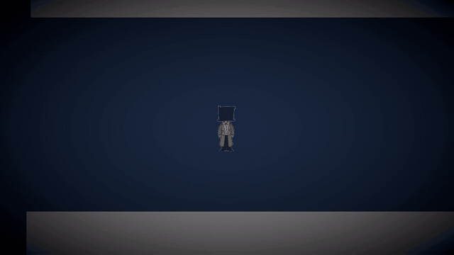

# Hi, I'm Ben Surya 👋
### Junior Gameplay Programmer · Unity & C#

## About me
I'm a Computer Science (Game Development) student at BINUS University in Jakarta, in my 5th semester. I make games in Unity and C#. I like programming the things that make a game feel good to play: movement, physics, and the feedback when something hits.

**Contact:** [LinkedIn](https://www.linkedin.com/in/ben-surya-801465326) · [Email](mailto:milkhalist@gmail.com)

## My games

<table width="100%">
  <tr>
    <th width="50%" align="left">Hole in the Wall</th>
    <th width="50%" align="left">Wobble Tower</th>
  </tr>
  <tr>
    <td valign="top"></td>
    <td valign="top"></td>
  </tr>
  <tr>
    <td valign="top">Walls with a hole slide toward you on a narrow platform. Move left and right, or jump, to get through the hole. Unity 6 · Solo</td>
    <td valign="top">A block slides back and forth above your tower. Press Space to drop it. Unity 6 · Solo</td>
  </tr>
  <tr>
    <td></td>
    <td></td>
  </tr>
</table>

<table width="100%">
  <tr>
    <th width="50%" align="left">Ring Out</th>
    <th width="50%" align="left">The Eye</th>
  </tr>
  <tr>
    <td valign="top"></td>
    <td valign="top"></td>
  </tr>
  <tr>
    <td valign="top">You stand on a round platform. Enemies drop in and push toward you. You have no weapon. Your dash is your attack and your dodge, on the same button. Unity 6 · Solo</td>
    <td valign="top">A short 2D horror game. You wake up in your bedroom, go to sleep, and a nightmare starts. Something is chasing you, and you have to keep running. Unity 2021.3.45f2 · 2 people</td>
  </tr>
  <tr>
    <td></td>
    <td></td>
  </tr>
</table>
