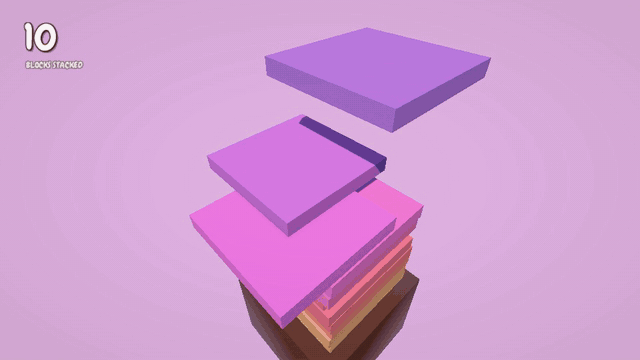
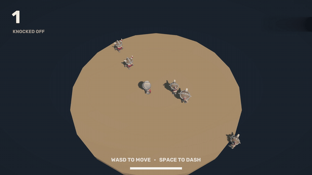
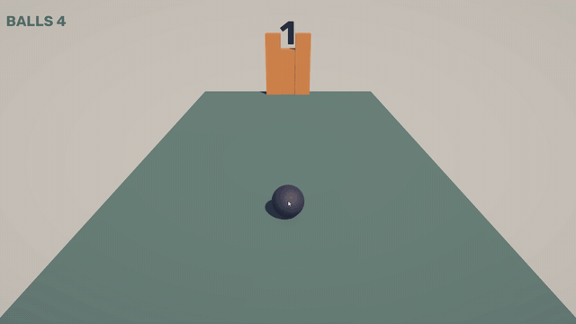

# Ben Surya

Junior gameplay programmer, Unity and C#.

I'm a 5th semester Computer Science (Game Development) student at BINUS University in Jakarta. Im heavily inspired by every feature I come across everyday I play games

**Contact:** [milkhalist@gmail.com](mailto:milkhalist@gmail.com) · [LinkedIn](https://www.linkedin.com/in/ben-surya-801465326)

## My games

<table width="100%">
  <tr>
    <th width="50%" align="left"><a href="https://github.com/Blazerdoom/Hole-in-the-Wall">Hole in the Wall</a></th>
    <th width="50%" align="left"><a href="https://github.com/Blazerdoom/Wobble-Tower">Wobble Tower</a></th>
  </tr>
  <tr>
    <td valign="top"></td>
    <td valign="top"></td>
  </tr>
  <tr>
    <td valign="top">Walls with a hole slide toward you. Step or jump through. A wall that hits you pushes you back instead of killing you. Unity 6 · solo · 8 days</td>
    <td valign="top">Drop sliding blocks to build a tower. Off-centre blocks aren't cut off, they make the tower lean. Unity 6 · solo · 5 days</td>
  </tr>
  <tr>
    <th width="50%" align="left"><a href="https://github.com/Blazerdoom/Ring-Out">Ring Out</a></th>
    <th width="50%" align="left"><a href="https://github.com/Blazerdoom/Sling-Shot">Sling Shot</a></th>
  </tr>
  <tr>
    <td valign="top"></td>
    <td valign="top"></td>
  </tr>
  <tr>
    <td valign="top">Knock enemies off a round platform. Your dash is your only attack and your only dodge. Unity 6 · solo · 2 days</td>
    <td valign="top">Pull back with the mouse and launch a ball at a tower of bricks. 5 balls per round. Unity 6 · solo · 7 days</td>
  </tr>
</table>

Click a game to see more GIFs, how it works, and what I did on it.
